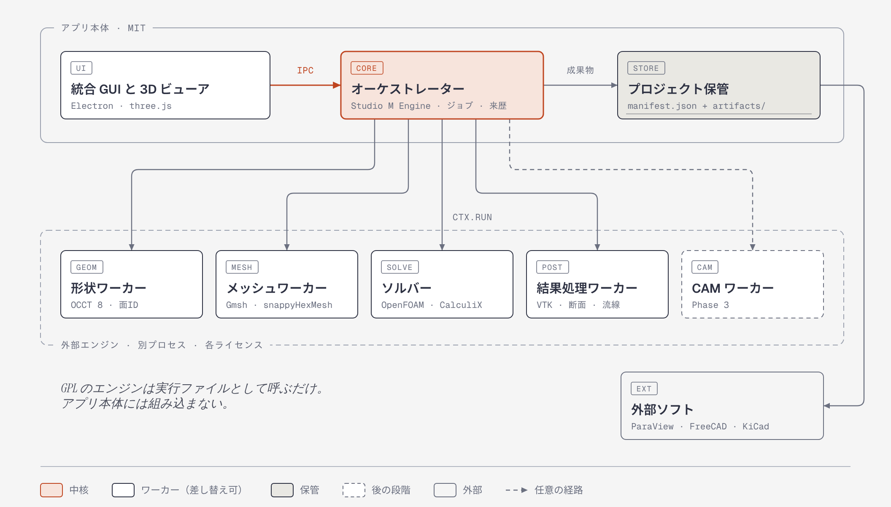
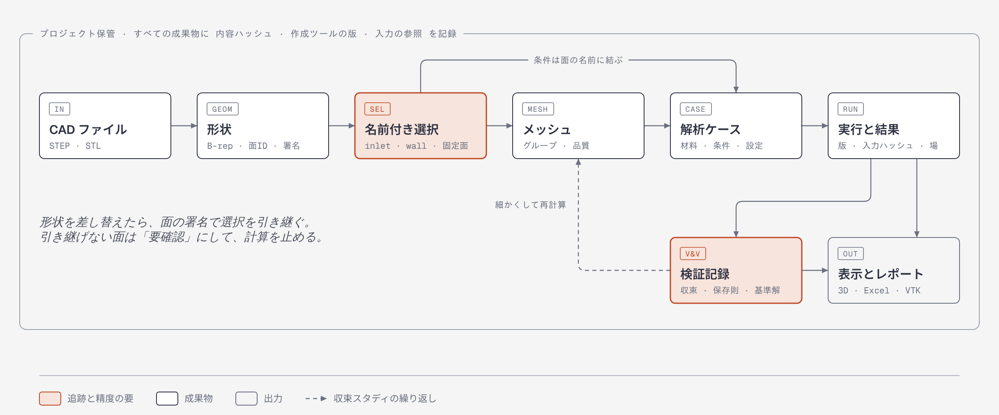

# Studio M 統合プラットフォーム 基本設計書

作成日: 2026-11-12。CAD・CAM・CAE・CFD を 1 つのアプリで扱う統合プラットフォームを、どの構成と技術で作るかを決めるための調査と基本設計である。今回はアプリのコードを変更していない。

2026-11-13: 14 章の判断事項を決めた。形は SolidCraft で作り、解析にかけるときは STEP に書き出して OCCT で読み直す。v0.6 から 3D に入る。

結論は、今の Studio M の構成を延長し、形状・メッシュ・ソルバーを別プロセスのエンジンとして追加していく方式である。最初の段階は「STEP を読み、外部流れの解析を 1 件、検証つきで最後まで実行する」ところまで絞るのがよい。

1. 構成方式は、独立した GUI が外部エンジンを別プロセスとして動かす方式を推奨する。既存のエンジンサーバーと CalculiX・OpenFOAM のアダプターをそのまま使えるうえ、GPL のエンジンをアプリ本体から切り離せる。FreeCAD は土台にせず、必要な機能だけを外部エンジンの 1 つとして呼ぶ（3 章）。
2. 第一候補は、形状が Open CASCADE（OCCT）、メッシュが Gmsh、流体が OpenFOAM、構造と熱が CalculiX である。4 つとも、今回この環境で動かすか、配布状況を一次情報で確かめた。開発機の M1 Mac では、OpenFOAM と CalculiX に公式のネイティブ配布がなく、ここが最初の難所になる（4 章）。
3. データモデルの中心は、面に付ける名前（名前付き選択）と、作成元を記録した成果物（来歴）の 2 つである。境界条件を面の名前に結ぶと、形状を差し替えても条件を追跡できる。今回の予備確認では、STEP の面に付けた名前が、Gmsh のグループを経て CalculiX と OpenFOAM の入力まで引き継がれた（6 章、12 章）。
4. 精度は、検証を工程に組み込んで確保する。予備確認の計算では、同じ設定の計算のうち 1 回だけ、反力が約 10.7% ずれた結果が出た。1 回の計算結果をそのまま信用しない仕組みが要る（7 章）。
5. これまでの方針と異なる提案が 2 つあった。主力の形状エンジンを SolidCraft から OCCT に改めることと、Python で動く作業プロセスを追加することである。2026-11-13 に、形は SolidCraft で作り、解析にかけるときは STEP に書き出して OCCT で読み直す、と役割を分けることに決めた。Python は導入する方向で、配布サイズを測ってから最終判断する（14 章）。
6. 最大のリスクは範囲の広さである。この設計の全体を 1 人で進めると、年単位の作業になると私は考えている。Phase 1 の範囲を絞り、実証実験の結果で続行を判断することを提案する（11 章、13 章）。

---

## 1. 記述の区分と、今回確かめた範囲

この文書では、記述を次の 3 つに分けて印を付ける。

| 印 | 意味 |
|---|---|
| 【事実】 | 今回の調査で確かめたこと。この環境で実行した結果か、公式リポジトリ・PyPI・公式サイトを 2026-11-12 に確認した結果 |
| 【提案】 | 設計上の提案 |
| 【仮説】 | 未検証のこと。文献や私の知識にもとづく記述で、今回は確かめ直していないものを含む |

実行して確かめた環境は、Linux（x86-64、4 コア、メモリ 15 GB）だけである。M1 Mac と Windows では何も実行していない。Mac と Windows についての【事実】は、配布物があるかどうかの確認にとどまる。

## 2. 現状: 2D の解析基盤とエンジン接続はあるが、3D の形状・メッシュ・表示はない

【事実】リポジトリの main には v0.1〜v0.5 が入っている。規模と中身は次のとおりである。行数はテストを除く TypeScript の行数を指す。

| 場所 | 行数 | 中身 |
|---|---|---|
| `src/core` | 1,193 | 共通の型、材料、格子化、エンジンとの通信の型 |
| `src/solvers` | 3,636 | ブラウザ内の 2D ソルバー（流れ・熱・強度・電磁波・対流拡散） |
| `src/workbench` | 1,952 | 解析ごとのまとめと登録表 |
| `src/ui` | 8,724 | 画面 |
| `src/learn`、`src/pcb`、`src/export` | 7,382 | 学習機能、KiCad 基板の取り込み、Excel 出力 |
| `engine/server` | 1,379 | PC 上の計算サーバー。ジョブの順番待ち、中止、認証 |
| `engine/adapters` | 3,657 | CalculiX と OpenFOAM の変換役 |

テストは通常の確認で 842 件、実際のエンジンを動かす結合テストで 208 件が通っている（2026-10-26 時点）。

【事実】データモデルは 2D 専用である。形状は長方形・円・多角形で、解析は正方形のセルを並べた格子の上で行う。結果も同じ格子に載る。3D の形状、非構造メッシュ、3D の表示、プロジェクトを保管する入れ物は、まだない。

【事実】既存のエンジン接続は、2D の範囲で理論値と照合済みである。

| 照合した量 | 理論値・基準 | ブラウザ内ソルバー | 外部エンジン |
|---|---|---|---|
| 鋼の片持ち梁のたわみ | 0.1855 mm | 0.1877 mm | CalculiX 0.1874 mm |
| アルミ板と 5 W の発熱体の最高温度 | — | 97.944 °C | CalculiX 97.925 °C |
| 円柱（Re = 100）のストローハル数 | — | 0.204 | OpenFOAM 0.201 |
| 翼型 NACA 0012（迎角 8°）の揚力係数 | 薄翼理論で約 0.88 | — | OpenFOAM 0.25〜0.40 |

翼型の値が大きく外れているのは、既存の OpenFOAM アダプターが、正方形のセルを階段状に積んで物体を表しているためである。形に沿ったメッシュが要ることを、この数字が示している。

引き継げるものと、作り直しになるものを分けると次のようになる。

- 引き継げる: エンジンサーバー、ジョブ管理、アダプターの契約、解析の登録表、判定カード、かんたん／標準／プロの切り替え、Excel 出力、理論値と照合するテストの習慣、OSS 台帳
- 作り直しになる: 形状の持ち方、メッシュ、結果の持ち方、3D の表示。OpenFOAM アダプターのうち格子を作る部分

## 3. 構成方式: 独立した GUI が外部エンジンを別プロセスで動かす

### 3 つの方式の比較

| 観点 | A. 単一アプリにエンジンを組み込む | B. FreeCAD を土台に拡張する | C. 独立した GUI が外部エンジンを制御する |
|---|---|---|---|
| 既存資産の活用 | TypeScript の資産をほぼ捨てる | 画面とデータモデルを捨てる | エンジンサーバーとアダプターをそのまま使う |
| ライセンス | Gmsh・CalculiX・OpenFOAM は GPL なので、組み込むとアプリ全体が GPL になる | FreeCAD は LGPL。GPL のソルバーは FreeCAD も外部実行している | 本体は MIT のまま。GPL のエンジンは別プロセス |
| 操作の一貫性 | 高い | FreeCAD の画面と文書モデルに従う | 自分で設計できる。その分、作る量が多い |
| Mac・Windows への配布 | 全エンジンを両 OS 向けに自分でビルドする | FreeCAD の公式配布を利用できる | エンジンごとに導入経路を選べる |
| 早く使えるようになる範囲 | どれも遅い | CAD・FEM・CAM が最初からある | CFD と構造は既存の延長で早い。CAD と CAM は遅い |
| 長期の拡張 | エンジンの差し替えが難しい | FreeCAD の版に追従し続ける | アダプターを追加すれば差し替えられる |

【事実】FreeCAD の最新安定版は 1.1 系（タグは 1.1.4）で、ライセンスは LGPL-2.1、macOS（Apple シリコン）と Windows の公式配布がある。1.1 のリリースノートには FEM と CAM の更新が載っている。

【提案】C を基本構成にする。A は、GPL のエンジンをライブラリとして結合する時点で、本体を MIT に保つという既存の方針と両立しない。B は CAD と CAM が早く得られるが、これまでに作った判定・学習・Excel 連携を FreeCAD の画面に作り直すことになり、ほかのソフトとの違いがなくなる。FreeCAD は、パラメトリックな形状編集と CAM を提供する外部エンジンの候補として、C の中で使う。

### 推奨する構成



図 1 の要点は 3 つある。

- 統合 GUI は、オーケストレーターにだけ指示を出す。エンジンを直接呼ばない
- オーケストレーターは、既存の Studio M Engine を広げたものである。ジョブの実行、成果物の記録、アダプターの管理を受け持つ
- 形状・メッシュ・ソルバー・結果処理は、それぞれ別プロセスのワーカーとして動く。ワーカーとのやり取りは、ファイルと、そのファイルを説明する JSON で行う

### モジュールの一覧

| モジュール | 責務 | 既存か新規か | 段階 |
|---|---|---|---|
| 統合 GUI | ワークフローの案内、設定、判定の表示 | 既存の `src/ui` と `src/workbench` を拡張 | 1 |
| 3D ビューア | 形状・メッシュ・結果の表示、面の選択 | 新規 | 1 |
| プロジェクト保管 | プロジェクトと成果物の保存、来歴の記録 | 新規 | 1 |
| オーケストレーター | ジョブ、資源の見積もり、成果物の登録 | 既存の `engine/server` を拡張 | 1 |
| 形状ワーカー | STEP・STL の読み込み、面の ID と署名、表示用の三角形化 | 新規 | 1 |
| メッシュワーカー | メッシュ生成、グループ付け、品質の報告 | 新規 | 1 |
| ソルバーアダプター | 入力ファイルの作成、実行、結果の読み取り | 既存の CalculiX・OpenFOAM を 3D に拡張 | 1〜2 |
| 結果処理ワーカー | 断面、等値面、流線、積分値の抽出 | 新規 | 1 |
| 検証ハーネス | ベンチマーク、収束スタディ、計算ごとの検算 | 新規。既存のテストの習慣を広げる | 1 |
| データ交換 | 外部ソフトとの受け渡しと、変換での損失の検出 | 新規 | 1〜2 |
| CAM ワーカー | 工具経路の生成、加工の確認 | 新規 | 3 |

プラグインの仕組みは、新しく作らない。既存のエンジンは「`engine/adapters/<名前>/` にフォルダーを置けばサーバーが自動で登録する」作りになっており、当面はこれで足りる。第三者が拡張を配る段階になってから、公開用の仕組みを検討する。

### ワーカーを Python で動かす案と、その代償

【提案】形状・メッシュ・結果処理のワーカーは、Python のスクリプトとして実装する。オーケストレーターから見ると、既存のアダプターが CalculiX を呼ぶのと同じ「コマンドの実行」になり、契約を変えずに追加できる。

【事実】必要なライブラリは、macOS（arm64）と Windows（x64）向けの配布物が PyPI にある。

| パッケージ | 版 | ライセンス | 役割 |
|---|---|---|---|
| cadquery-ocp | 8.0.1.1.0 | Apache-2.0（中身の OCCT は LGPL-2.1） | OCCT 8.0.1 の Python バインディング |
| gmsh | 4.15.2 | GPL-2.0-or-later | メッシュ生成 |
| vtk | 9.7.2 | BSD | 結果の抽出と変換 |
| netgen-mesher | 6.2.2608 | LGPL-2.1 | メッシュ生成の代替 |

【事実】代償は配布サイズである。この環境で cadquery-ocp・gmsh・numpy を入れた仮想環境は 1.4 GB になった。

代替案は 3 つある。OCCT を WebAssembly にした opencascade.js は、追加のランタイムが要らないが、リポジトリのタグが v2.0.0-beta のままである【事実】。C++ で専用のサービスを書く案は、性能は最良だが両 OS 向けのビルドを自分で保守することになる。FreeCAD をコマンドラインで呼ぶ案は、形状と CAM をまとめて得られるが、起動に時間がかかる【仮説】。配布サイズと起動時間は、実証実験 4 で測ってから決める。

### 16 GB のメモリで動かすための資源管理

【事実】予備確認で、CalculiX 2.21（SPOOLES という直接法の連立方程式ソルバー、4 スレッド）の最大メモリを測った。対象は 2 次の四面体要素である。

| 節点数 | 自由度 | 最大メモリ | 計算時間 |
|---|---|---|---|
| 13,961 | 約 4.2 万 | 439 MB | 2.1 s |
| 35,392 | 約 10.6 万 | 802 MB | 8.6 s |
| 76,362 | 約 22.9 万 | 2,055 MB | 18.9 s |
| 153,785 | 約 46.1 万 | 5,227 MB | 60.6 s |

【仮説】16 GB の Mac でソルバーが使えるメモリを 8〜10 GB と見ると、この組み合わせでは 25〜30 万節点が上限の目安になる。OpenFOAM は 100 万セルあたり 1〜2 GB という経験則がフォーラムで語られているが、公式の数値は見つからなかった。メッシュ生成のほうが先にメモリを使い切る場合もある。

【事実】計算に使う Windows 機は、Ryzen 7 7800X3D（8 コア 16 スレッド）、メモリ 32 GB、GTX 1080 である（2026-11-13 の利用者の申告）。

【仮説】上の表の増え方が続くとみなすと、ソルバーが 20〜24 GB を使える場合、同じ組み合わせで 45〜50 万節点が上限の目安になる。CalculiX と OpenFOAM は基本的に CPU で計算するので、GPU が役に立つのは主に 3D の表示である。重い計算を Windows 機で動かし、Mac の画面から使う経路（下の 4 点目）は、この 2 台の構成で特に役に立つ。

【提案】資源管理は次の 4 点とする。

- 実行前に、要素数からメモリと時間を見積もる。見積もりが上限を超える計算は始めず、メッシュを粗くするよう案内する
- 同時に実行する計算は 1 件、スレッド数は高性能コアの数を既定にする
- 実行ごとに最大メモリと時間を記録し、次回の見積もりの係数に使う
- 通信の形を今の HTTP のまま保ち、後から別の PC やクラウドで同じエンジンを動かせるようにする。これは Phase 1 には含めない

## 4. 技術選定: 候補の比較と選定理由

表の「確認」は、◎ が今回一次情報か実行で確かめたもの、△ が今回は確かめ直していないものを示す。

### 形状

| 候補 | 版・ライセンス | Mac・Windows | 連携の方法 | 確認 | 判定 |
|---|---|---|---|---|---|
| Open CASCADE（OCCT） | 8.0.1、LGPL-2.1 と独自の例外条項 | Python バインディングの配布物が両 OS にある | Python、C++ | ◎ | 採用。解析側で STEP を読み、面に番号と名前を付ける（14 章） |
| FreeCAD | 1.1.4、LGPL-2.1 | 公式配布が両 OS にある | Python API、コマンドライン実行 | ◎（API は △） | 土台にはしない。形状編集と CAM の外部エンジン候補 |
| build123d | 0.13.0、Apache-2.0 | Python だけで書かれている | OCCT の上で、コードで形を作る | ◎ | Phase 2 のパラメトリック形状に使う候補 |
| SolidCraft | MIT と Apache-2.0 の選択式 | 両 OS のアプリがある | STEP・STL などの読み書き、コマンドライン、MCP | ◎（11 月 13 日に確認） | 採用。形を作るアプリとして使い、解析へは STEP で渡す（14 章） |
| opencascade.js | LGPL-2.1 | ブラウザと Node.js | WebAssembly | ◎ | 見送り。タグがベータ版だけ |

【事実】OCCT の例外条項は、ヘッダーファイルの内容を取り込んだオブジェクトコードを、告知を条件に任意の条件で配布できるとしている。

【事実】バインディングは版によって書き方が変わる。今回、OCCT 7 系の解説にある `TopoDS.Face_s` が 8.0.1 では使えず、`TopoDS.Face` に書き換えた。形状ワーカーの中に変換層を置き、版を固定する必要がある。

【事実】SolidCraft の README（2026-11-13 確認）は、自らを「Early but usable for simple parts」（初期段階で、単純な部品なら使える）と説明している。STEP・IGES・3MF・STL・OBJ・glTF の読み書きは「where supported」（対応している範囲で）とある。コマンドライン（`solidcraft-cli`）と MCP サーバーがあり、コミットは 8,654 件ある。形状カーネルの名前は README に書かれていない。

### メッシュ

| 候補 | 版・ライセンス | Mac・Windows | 特徴 | 確認 | 判定 |
|---|---|---|---|---|---|
| Gmsh | 4.15.2、GPL-2.0-or-later と例外条項 | 両 OS の配布物がある | 四面体が中心。STEP を自前の OCCT で読む。Python・C++ の API | ◎ | 採用。別プロセスのメッシュワーカーとして使う |
| Netgen | 6.2.2608、LGPL-2.1 | 両 OS の配布物がある | 四面体。Python API | ◎（品質は △） | 代替。ライセンスの条件が軽い |
| snappyHexMesh | OpenFOAM に同梱、GPL-3.0 | OpenFOAM に従う | 六面体が中心。壁面近くの層状メッシュを作れる | △ | 外部流れ用の候補。OpenFOAM がある環境に限る |
| TetGen | AGPL-3.0 | — | 四面体 | △ | 見送り |

【事実】Gmsh の公式サイトは、閉じたソースのソフトに Gmsh の一部を組み込む場合は商用ライセンスが必要だと書いている。作者は 2019 年のメーリングリストで、Gmsh にリンクするソフトは一般に GPLv2 以降になるという理解を示している。

### 流体

| 候補 | 版・ライセンス | Mac・Windows | 特徴 | 確認 | 判定 |
|---|---|---|---|---|---|
| OpenFOAM（openfoam.com） | v2606（2026-06-26）、GPL-3.0 | Windows は WSL・MinGW でビルドした版・Docker。macOS は公式のネイティブ配布なし | 非圧縮・圧縮・多相・熱連成まで広い。既存アダプターあり | ◎ | Phase 1 の主エンジン |
| SU2 | v8.6.0、LGPL-2.1 | README は Linux・macOS・Windows のビルド済みバイナリがあるとする | 翼まわりの流れと形状最適化が得意 | ◎（v8 の配布内容は △） | 代替候補。実証実験 6 で評価 |
| ブラウザ内の格子ボルツマン法 | 既存 | ブラウザ | 2D。すぐ結果が出る | ◎ | 本計算の前に傾向を見る用途で残す |

【事実】OpenFOAM の Windows 向け MinGW 版は、OpenFOAM 自体のコンパイルと動的コードに対応しない。macOS については、第三者が Apple シリコン向けにビルドした OpenFOAM.app（v2.2.3）がある。

### 構造・熱

| 候補 | 版・ライセンス | Mac・Windows | 特徴 | 確認 | 判定 |
|---|---|---|---|---|---|
| CalculiX | 2.23（2025-10）、GPL-2.0-or-later | macOS arm64 の公式バイナリは見つからない。Windows は第三者のビルド | 静解析、塑性、接触、固有値、熱。既存アダプターあり | ◎（ライセンスは △） | 主エンジン |
| Elmer | 26.2.1、GPL。ソルバーのライブラリは LGPL | Windows はインストーラーあり。macOS はソースから | 熱、電磁場、連成 | ◎ | Phase 2〜3 の候補 |
| Code_Aster | GPL | Windows は第三者の移植。macOS は情報が見つからない | 非線形に強い | △ | 見送り。配布が難しい |

### 表示・基盤・その先

| 候補 | 版・ライセンス | 役割 | 確認 | 判定 |
|---|---|---|---|---|
| Electron | 安定版 45.3.2、MIT | デスクトップアプリの土台 | ◎（ライセンスは △） | 採用（既存の方針どおり） |
| three.js | MIT | 3D の表示と面の選択 | △ | 採用候補。実証実験 5 で確認 |
| vtk.js | BSD-3-Clause | 科学技術向けの表示 | △ | three.js と比較する |
| VTK | 9.7.2、BSD | 結果の抽出と変換 | ◎ | 採用。結果処理ワーカーで使う |
| ParaView | BSD | 高度な後処理 | △ | 外部ソフトとして連携 |
| OpenCAMLib | LGPL-2.1 | 工具経路の計算 | ◎ | Phase 3 の候補 |
| Kiri:Moto | MIT | ブラウザで動く CAM とスライサー | ◎ | Phase 3 の候補 |
| preCICE | v3.5.0、LGPL-3.0 | ソルバーどうしの連成 | ◎ | Phase 3 の候補 |

### 選定理由

- OCCT を選ぶ理由は、成熟度と配布のしやすさである。STEP の読み書きを含めて実績が長く、両 OS の配布物を今回確かめた。Gmsh も内部で OCCT を使うため、同じ STEP を読んだときの面の対応が取りやすい。形を作る作業は SolidCraft に任せ、OCCT は解析にかける形を STEP から読み込む役に使う（14 章）
- Gmsh を選ぶ理由は、今回の予備確認で、面の対応、グループ付け、CalculiX 用と OpenFOAM 用の出力までを一続きで実行できたことである。GPL の扱いは 9 章にまとめる
- OpenFOAM と CalculiX を選ぶ理由は、既存のアダプターと照合結果があることである。ただし 2 つとも、開発機の M1 Mac に公式のネイティブ配布がない。導入経路を先に確かめる必要がある

## 5. モジュール間インターフェース

### 原則

- 型は `src/core` の契約に置き、追加する項目は省略可能にする。これは既存の規則と同じである
- 大きなデータは JSON に入れない。ファイルとして置き、JSON にはその場所・形式・ハッシュを書く
- ワーカーは標準の形式で受け渡す。形状は STEP と OCCT の BREP、メッシュは Gmsh の MSH と各ソルバーの入力形式、結果は VTK の形式を使う

### 成果物の記述子

すべてのワーカーは、作ったファイルを次の形で登録する。

```ts
interface ArtifactRef {
  id: string;
  kind: 'geometry' | 'mesh' | 'case' | 'result' | 'view' | 'toolpath';
  /** 中身から計算したハッシュ。同じ中身なら同じ値になる */
  hash: string;
  files: { role: string; path: string; format: string }[];
  /** どのツールのどの版が、どの設定で作ったか */
  producedBy: { tool: string; version: string; adapter: string; options: unknown };
  /** 入力に使った成果物の id */
  derivedFrom: string[];
  createdAt: string;
}
```

### 段階ごとの契約

既存のアダプターは「プロジェクトを受け取り、結果を返す」1 種類だけである。これを段階ごとに分ける。

| 段階 | 入力 | 出力 |
|---|---|---|
| 形状 | CAD ファイル、長さの単位 | 形状の成果物。面・辺・立体の一覧と署名、表示用の三角形、体積と表面積 |
| メッシュ | 形状、名前付き選択、メッシュの設定、用途 | メッシュの成果物。グループの対応表、要素数、品質の指標、選択ごとの面積の照合 |
| 計算 | メッシュ、解析ケース | 実行記録と結果の成果物 |
| 結果処理 | 結果、取り出したいもの | 表示用のデータ、積分値 |
| CAM | 形状、加工の設定 | 工具経路、G コード |

```ts
interface StageAdapter<Input, Output> {
  id: string;
  stage: 'geometry' | 'mesh' | 'solve' | 'post' | 'cam';
  /** 対応する物理、境界条件の種類、要素の種類、選べる設定 */
  capabilities: Capability[];
  detect(ctx: DetectContext): Promise<EngineInfo>;
  /** 実行前の見積もり。省略可 */
  estimate?(input: Input): { memoryBytes: number; seconds: number };
  run(input: Input, ctx: AdapterContext): Promise<Output>;
}
```

既存の `EngineAdapter.solve` は、2D の格子を入力とする「計算」段階として残す。進み具合、ログ、中止は、既存の `ctx.progress`・`ctx.log`・`ctx.signal` をそのまま使う。

### 能力の宣言と、対応していない条件の扱い

アダプターは、対応する境界条件や物理モデルを `capabilities` で宣言する。画面はこの宣言から選択肢を作る。宣言にない条件が解析ケースに含まれていたら、実行前にエラーにする。利用者に知らせずに近い条件へ置き換えることはしない。

## 6. 共通データモデルの基本仕様



### プロジェクトの入れ物

【提案】プロジェクトは 1 つのフォルダーにする。設定は人が読める JSON、大きなファイルはハッシュごとのフォルダーに置く。

```
my-part.studiom/
  manifest.json        スキーマの版、単位、座標系、成果物の一覧
  studies/             解析ケース（材料、条件、数値設定）
  artifacts/<hash>/    形状、メッシュ、結果のファイル
  runs/<id>/           実行記録（入力のハッシュ、ソルバーの版、ログ、残差）
```

配布や受け渡しのときは、このフォルダーを zip にまとめる。

### 主な要素

| 要素 | 持つ情報 |
|---|---|
| 形状 | 元ファイルのハッシュ、カーネルの版、面・辺・立体の一覧、各面の署名 |
| 名前付き選択 | 面や立体の ID の集合に、利用者が付けた名前。例は inlet、wall、固定面 |
| 材料 | 物性値、単位、出典、適用できる温度範囲。プロジェクトには使った時点の写しを持つ |
| 解析ケース | 物理の種類、材料の割り当て、境界条件、数値設定。境界条件の対象は名前付き選択 |
| メッシュ設定とメッシュ | 全体と局所の寸法、アルゴリズム。生成結果、グループの対応表、品質の指標 |
| 実行記録 | 解決済みの入力のハッシュ、ソルバーとアダプターの版、スレッド数、OS と CPU、ログ |
| 結果 | 場のデータ、積分値、履歴 |
| 検証記録 | 収束スタディ、保存則の収支、基準解との差 |

### 形状とメッシュの対応

【提案】面には取り込み時に ID を振り、署名を保存する。署名は、面の種類、面積、重心、外接する箱、隣り合う面の数からなる。境界条件は面の ID に直接結ばず、名前付き選択に結ぶ。

【事実】予備確認では、OCCT 8.0.1 と Gmsh 4.15.2 が同じ STEP を別々に読み、7 つの面が面積と重心の一致で 1 対 1 に対応した。Gmsh のグループ名 FIX・LOAD は CalculiX の節点集合になり、inlet・outlet・walls は OpenFOAM のパッチ名になった。

【事実】形状を変えたときの追跡は、単純な規則では足りない。穴の径を 20 mm から 24 mm に変えた場合は、7 面すべてを追跡できた。穴を 30 mm 動かした場合は、「同じ種類で、重心が近い面」という規則では、穴の円筒面に対応する面が見つからなかった。

【提案】追跡は次の順に行う。追跡できなかった面を使う条件は「要確認」にし、利用者が確かめるまで計算を始めない。

1. STEP に名前や色が書かれていれば、それを使う
2. 署名が一致する面を同じ面とみなす
3. 種類と位置が近い候補が 1 つだけなら、「変更あり」として引き継ぐ
4. 候補が複数あるか、見つからなければ、「要確認」にする

Phase 2 でアプリ内の形状編集を加えるときは、カーネルが持つ編集履歴から面の対応を取る【仮説】。これは「トポロジカルネーミング問題」として知られる難題で、FreeCAD も 1.0 と 1.1 で対策を続けている【事実】。

### 単位と座標系

【提案】内部の値は SI 単位（m、kg、s、K、Pa）に統一し、画面の表示だけを mm や MPa に変える。座標系は右手系で、上向きの軸と重力の向きをプロジェクトに明記する。

【事実】単位の取り違えは実際に起きうる。予備確認では、mm で書いた STEP を Gmsh が 400 × 100 × 10 という数値のまま読んだ。既存コードの長さは m である。形状ワーカーが取り込み時に単位を確定し、換算の係数を成果物に記録する必要がある。STL は単位を持たないので、取り込み時に必ず利用者に確認する。

【事実】既存の設定には、温度を °C で持つ項目がある。新しいデータモデルに移すときに K へ統一する。

### ソルバーごとの差の扱い

【提案】解析ケースは 3 層で持つ。

- 共通の意図: 「速度で流入」「固定」「熱伝達」のような、ソルバーに依存しない条件
- 対応表: 各アダプターが、共通の意図を自分の入力形式にどう書き換えるか。圧力の定義、符号、壁関数、要素の種類などの違いを文書に残す
- 上書き: ソルバー固有の設定を利用者が直接書いたもの。実行記録に残す

### 既存の 2D モデルとの関係

既存の 2D のプロジェクトは、形状の種類の 1 つ（2D の格子）として新しい入れ物に読み込めるようにする。ブラウザ内のソルバーは 2D 専用のまま残し、傾向の確認と学習に使う。

## 7. 検証と品質保証: 1 回の計算結果をそのまま信用しない

### なぜ工程に組み込むのか

【事実】予備確認で、円孔のある平板を CalculiX 2.21 で計算した。メッシュは 2 次の四面体 44,557 要素である。最初の 1 回は、反力が 56,942.7 N、応力集中係数が 2.92 になった。同じ設定で入力を作り直して 5 回計算すると、5 回とも反力は 51,421.6 N、応力集中係数は 3.147 だった。粗いメッシュと細かいメッシュの反力も 51,420〜51,435 N である。最初の 1 回だけが誤っていたと判断できる。

最初の入力ファイルは上書きされて残っていない。要素数と節点数は同じだったが、入力が完全に同一だったことは証明できない。

【仮説】原因は並列処理の競合と推定する。v0.5 の作業でも、CalculiX 2.21 が計算機の混雑時にまれに誤った応力を出す現象を確認している。

この結果から、見た目に破綻がなくても数値が誤っている場合があると分かる。

### 3 層の検証

| 層 | 問い | 方法 | 実行の時期 |
|---|---|---|---|
| コードの検証 | 方程式を正しく解いているか | 解析解のある問題と比べる | ソルバーやアダプターの版を変えたとき |
| 妥当性の確認 | 現実の現象を再現するか | 実験値や基準解のある問題と比べる | 同上 |
| 計算ごとの検算 | この計算は信用できるか | 下の項目を毎回自動で確かめる | すべての計算 |

### 計算ごとの検算

【提案】すべての計算で次を確かめ、結果と一緒に表示する。

- 収束: 残差が基準まで下がったか。積分値が落ち着いたか
- 保存則: 流れでは流入と流出の質量流量の差、構造では荷重と反力の釣り合い、熱では発熱と放熱の収支
- メッシュの品質: 流れでは非直交性と歪み、構造では要素のつぶれ
- 形状との照合: 選択ごとに、メッシュ上の面積と CAD の面積を比べる
- 再計算: 検算で不合格になったときや、粗いメッシュの結果から外れたときは、もう一度計算して比べる

【事実】面積の照合は実際に機能する。予備確認では、平面のグループは CAD と一致し（1,000.0 mm²）、穴の円筒面は直線近似のぶん 0.07% 小さかった（628.319 に対して 627.875 mm²）。

### メッシュ収束性の評価

【提案】収束スタディを 1 つの操作として用意する。メッシュを 3 段階に細かくし、注目する量の変化から、離散化による誤差の見積もりを出す。見積もりには、格子収束指数（GCI）と呼ばれる標準的な手順を使う【仮説】。

【事実】細かくし方には注意が要る。予備確認で全体の最大寸法だけを 10・6・4・3 mm と変えたところ、積分点での応力集中係数は 3.129・3.151・3.147・3.115 と、単調には変化しなかった。注目する場所（穴の縁）の細かさが、全体の寸法に比例して変わらなかったためと推定する。収束スタディでは、局所の寸法も同じ比率で変える必要がある。

【仮説】16 GB のメモリでは、3 段階目のメッシュがメモリに収まらない問題が出る。その場合は 2 段階の比較にとどめ、誤差の見積もりは出せないと明示する。

### ベンチマークの一覧

基準値は文献によるもので、今回は原典を確かめ直していない【仮説】。採用時に原典で確認し、合格の目安を確定する。

| 問題 | 物理 | 比べる相手 | 合格の目安 | 段階 |
|---|---|---|---|---|
| 円管の層流 | 流れ | ハーゲン・ポアズイユの式 | 圧力損失の差 2% 以内 | 1 |
| 蓋が動く正方形の空洞 | 流れ | Ghia ら（1982）の速度分布 | 中心線の速度の差 2% 以内 | 1 |
| 円柱まわりの流れ（Re = 100） | 流れ | ストローハル数とその文献値 | 差 5% 以内 | 1 |
| 翼型 NACA 0012 | 流れ（乱流） | NASA の乱流モデル検証サイトの揚力・抗力 | 差 5〜10% 以内 | 1 |
| 後ろ向きの段差 | 流れ | 再付着の位置の実験値 | 文献のばらつきの範囲 | 1〜2 |
| 片持ち梁 | 構造 | 梁の理論 | たわみの差 2% 以内 | 2 |
| 円孔のある平板 | 構造 | 応力集中係数の近似式 | 差 3% 以内 | 2 |
| 内圧を受ける厚肉円筒 | 構造 | ラメの式 | 差 2% 以内 | 2 |
| 梁の固有振動数 | 構造 | 梁の理論 | 差 2% 以内 | 2 |
| 棒とフィンの熱伝導 | 熱 | 解析解 | 差 1% 以内 | 2 |
| NAFEMS の標準問題 | 構造・熱 | 公表されている目標値 | 目標値の許容差 | 2 |

【事実】円孔のある平板は、予備確認で先に試した。積分点の値は 3.115〜3.151、近似式は 3.149 で、差は 1.1% 以内に収まった。節点に外挿した値は 3.25〜3.30 で、近似式より 3〜5% 高い。近似式は板厚方向の変化を考えない式なので、この差が誤差なのか 3D の効果なのかは、まだ切り分けていない。

### 再現性

【提案】実行記録に、解決済みの入力一式のハッシュ、ソルバーとアダプターの版、スレッド数、OS と CPU を残す。ソルバーの版はプロジェクトごとに固定し、版を上げたらベンチマークをやり直す。並列数が変わると数値の末尾は変わるので、再現性は「主要な積分値が許容差の中で一致すること」と定義する。

### ファイル変換での情報の損失

【提案】変換の前後で、変わらないはずの量を比べる。形状では体積・表面積・外接する箱・面の数、メッシュでは節点と要素の数・グループごとの面積、結果では場の最小・最大・積分値である。変換を行うアダプターは、保つ情報と落とす情報を宣言する。

【事実】損失は予備確認でも起きた。Gmsh が CalculiX 用に出力したファイルでは、体積のグループに付けた名前 SOLID が要素集合の名前にならず、Volume1 になった。面の要素が混ざって出力されるため、取り除く処理も必要だった。

## 8. UX: 工程を見せ、結果の信頼度を先に見せる

【提案】画面は、左にワークフローの段、中央に 3D ビュー、右にその段の設定と判定を置く。段は「形状 → 名前付け → 材料 → メッシュ → 条件 → 計算 → 結果 → 検証」とし、それぞれに状態を表示する。状態は、未設定・要確認・準備完了・古い、の 4 つである。上流を変えると、下流の段は自動で「古い」になる。

初心者向けには、既存の 3 つのモードを使う。

- かんたん: 問題の型を選ぶ。外部流れ、管の中の流れ、固定して荷重をかける、発熱と放熱の 4 つから始める。設定は自動で決め、決めた理由を表示する
- 標準: 物理量を単位つきで設定する
- プロ: ソルバー固有の設定を直接書ける。書いた内容は実行記録に残る

計算の前には、実行前チェックを行う。単位、条件が付いていない面、メッシュの品質、メモリと時間の見積もりを確かめ、問題があれば直し方を示す。

結果の画面では、色の付いた図より先に、信頼度のまとめを見せる。収束・保存則・メッシュの品質・収束スタディの有無を「確認済み」「未確認」で示す。既存の判定カードをこの形に広げる。ブラウザ内の 2D ソルバーは、本計算の前に傾向を確かめる手段として、同じ画面から使えるようにする。

## 9. ライセンスと配布: 本体と GPL のエンジンを分け、未確認の点は専門家に確かめる

この章は法的な助言ではない。商用利用が可能かどうかは、この設計書では判断しない。

### 連携の形による違い

| 連携の形 | GPL のソフト | LGPL のソフト | 区分 |
|---|---|---|---|
| ライブラリとして結合する | 結合した全体が GPL になる | 差し替えられる形での結合と告知を条件に、本体は別のライセンスにできる | 【仮説】 |
| 別プロセスとして実行し、ファイルやコマンドで受け渡す | 別々のプログラムと扱われるのが一般的とされる。ただし、やり取りが密な場合は 1 つの著作物とみなされる余地がある | 同左 | 【仮説】 |
| 実行ファイルをアプリに同梱して配る | そのプログラムのライセンス文の同梱と、ソースの提供が要る | 同左 | 【仮説】 |
| 利用者が自分で入れたものを検出して使う | 配布者の義務はもっとも軽い | 同左 | 【仮説】 |

この表の内容は、フリーソフトウェア財団の解説などにもとづく私の理解である。今回は財団のサイトに接続できず、原文を確かめ直していない。

### 確認できた事実

- Gmsh は GPL-2.0-or-later で、閉じたソースへの組み込みには商用ライセンスが必要だと公式サイトが書いている
- OCCT は LGPL-2.1 で、ヘッダーの取り込みに関する例外条項がある
- OpenFOAM の商標ガイドラインは、名称の使用を OpenCFD 社のソフトを指す目的に限り、提携や承認を示唆しないことを求めている。OpenFOAM 向けの拡張は、関係を示す形で名称を使えるとしている

### 設計への反映

【提案】

1. アプリ本体には GPL のコードを結合しない。これは既存の規則と同じである
2. Gmsh の Python API を使うメッシュワーカーは、本体とは別の GPL-2.0-or-later のプログラムとして公開する。本体とはファイルだけでやり取りする
3. エンジンの導入経路を、同梱・追加パック・利用者が導入済みのものの検出、の 3 つにする。どの経路で使っているかを OSS 台帳に記録する
4. 画面では「OpenFOAM で計算」のように、エンジンを指す目的でだけ名称を使う。製品名には使わない
5. 商用配布を検討する時点で、メッシュを Netgen（LGPL）に差し替えるか、Gmsh の商用ライセンスを得るかを選べるように、メッシュワーカーを差し替え可能に保つ

### 法的に未確認の事項

- 別プロセスでの連携が、どこまで「別々のプログラム」と認められるか
- GPL の実行ファイルを同梱する場合の、ソース提供の具体的な方法
- Python のワーカーを本体と同じインストーラーで配る場合の扱い
- macOS のアプリストアでの配布と GPL の両立
- 商標の扱いの細部

商用配布を決める前に、これらを専門家に確認することを前提条件とする。

## 10. 開発ロードマップ

2026-11-13 の決定で、v0.6 から 3D に入る。Phase 1 は v0.6（Studio M Pro と 3D の土台）と v0.7（3D の外部流れ）、Phase 2 は v0.8（3D の強度と熱）と v0.9（SolidCraft・AI 連携）、Phase 3 は v1.1 以降に当たる。版ごとの中身は `docs/ROADMAP.md` にある。

### Phase 1: CFD を中心とした実用的な最小版

目的は、STEP の形状を読み、メッシュ・計算・表示までを、検証つきで 1 件、最後まで実行できるようにすることである。

| 順 | 作るもの | 依存 |
|---|---|---|
| 1 | デスクトップアプリ化とエンジンの内蔵（既存の v0.6 の方針） | なし |
| 2 | プロジェクトの入れ物と成果物の登録 | 1 |
| 3 | 形状ワーカー（STEP・STL、面の ID と署名、単位の確定）と 3D ビューア | 2 |
| 4 | 名前付き選択と、外部流れ用の流体領域の作成 | 3 |
| 5 | メッシュワーカー、品質の報告、面積の照合 | 4 |
| 6 | OpenFOAM アダプターの 3D 対応（定常の非圧縮流れ） | 5 |
| 7 | 結果処理（断面、表面の分布、流線、力） | 6 |
| 8 | 計算ごとの検算、収束スタディ、Phase 1 のベンチマーク | 6、7 |

- 技術的リスク: M1 Mac での OpenFOAM の導入、壁面近くの層状メッシュ、流体領域の作成、配布サイズ
- 検証方法: 7 章のベンチマークのうち段階 1 のもの、再計算での一致、形状差し替えの試験
- 完成条件
  1. M1 Mac（16 GB）と Windows で、STEP の取り込みから結果の表示までがアプリの中で完結する
  2. 段階 1 のベンチマークが、定めた合格の目安に入る
  3. 形状を差し替えたとき、変わっていない面の条件が自動で引き継がれ、誤った引き継ぎが試験セットで 0 件である
  4. 同じプロジェクトを再計算して、主要な積分値が 0.1% 以内で一致する
  5. メモリの見積もりが上限を超える計算は始まらない
  6. 既存の機能が動き続け、既存のテストがすべて合格する

### Phase 2: CAD と CAE の統合

目的は、寸法を変えて再計算する設計の繰り返しを、アプリの中で行えるようにすることである。

- 範囲
  - 形状の編集: 寸法の表とコードによる形状作成から始め、面の分割や小さな形状の除去を加える。スケッチと拘束による作図は後半にする
  - 構造: CalculiX の 3D 対応。線形静解析、塑性、接触、固有値
  - 熱: 定常の熱伝導、熱応力
  - 流れと固体の熱の受け渡し（片方向）
- 依存: Phase 1 の形状・メッシュ・保管・検証の基盤
- 技術的リスク: 編集後の面の追跡、接触解析の収束、メモリの上限
- 検証方法: 7 章の段階 2 のベンチマーク、寸法を変えた 5 案の比較
- 完成条件
  1. 寸法の変更から再メッシュ、条件の引き継ぎ、再計算までを、5 案の比較で人手の修正なしに実行できる
  2. 段階 2 のベンチマークが合格の目安に入る
  3. 面の追跡の成功率を試験セットで測り、公表している

### Phase 3: CAM と高度な連成解析

目的は、加工の準備と、複数の物理をまたぐ検討を加えることである。

- 範囲
  - CAM: 輪郭・ポケット・穴あけの工具経路、機械ごとの出力形式、加工の確認。3D プリント用のスライサーへの受け渡し
  - 連成: preCICE による流体と構造の連成、双方向の熱連成
  - 設計最適化: 寸法を振る実験計画と最適化
- 依存: Phase 2 の形状編集と、安定したアダプターの契約
- 技術的リスク: 工具経路の誤りは、機械の破損やけがにつながる。連成計算は不安定になりやすく、計算時間も長い
- 検証方法: 加工シミュレーションでの干渉の確認、空運転での確認、連成の公開チュートリアル問題の再現
- 完成条件
  1. 基準の部品の G コードが、加工シミュレーションと空運転で確認できる
  2. 連成の標準問題を、基準の許容差の中で再現できる
  3. 最適化の全試行が、来歴つきで再現できる

## 11. 主な技術的リスクと回避策

| リスク | 根拠 | 回避策 |
|---|---|---|
| 範囲が広く、1 人では終わらない | この設計の全体は 11 個のモジュールと 3 段階からなる【事実】 | 段階ごとに完成条件を置き、実証実験の結果で続行を判断する。Phase 1 を外部流れに絞る |
| M1 Mac でソルバーが動かない | OpenFOAM と CalculiX に macOS arm64 の公式配布がない【事実】 | 実証実験 4 で導入経路を先に確かめる。第三者のビルド、自前のビルド、SU2 への切り替えを比べる |
| 形状変更後に条件の対象が分からなくなる | 単純な規則では、穴を動かしただけで対応する面が見つからなかった【事実】 | 追跡できない面は「要確認」にして計算を止める。誤った引き継ぎを 0 件に保つことを優先する |
| 誤った計算結果に気づけない | 1 回だけ反力が 10.7% ずれた【事実】 | 釣り合いの検算、収束スタディ、再計算を標準にする |
| メモリが足りない | 46 万自由度で 5.2 GB【事実】 | 実行前の見積もりと上限。別の PC で動かす経路を残す |
| 配布物が大きくなる | Python の環境が 1.4 GB【事実】 | 使うライブラリを絞る。追加パックに分ける |
| 商用配布でライセンスが問題になる | Gmsh は閉じたソースへの組み込みに商用ライセンスを求める【事実】 | 本体と GPL のワーカーを分ける。Netgen への差し替えを可能にする。専門家に確認する |
| ライブラリの版が上がって壊れる | OCCT 8 でバインディングの書き方が変わった【事実】 | 変換層と版の固定。版を上げる手順にベンチマークを含める |
| 自動メッシュが失敗する | 壁面近くの層状メッシュと、すき間や重なりのある CAD データは、商用ソフトでも難しいとされる【仮説】 | 問題の型ごとのテンプレート、品質の合格基準、形状を簡略化する機能 |
| Windows で日本語を含むパスで失敗する | CAE のツールには、日本語や空白を含むパスで失敗するものがある【仮説】 | 作業フォルダーを英数字だけの短いパスに置く。実証実験 4 で確かめる |
| 3D の表示が遅い | 未測定【仮説】 | 結果の抽出と間引きをワーカー側で行う。実証実験 5 で測る |
| 見た目の整った図を見て、誤った結果を信用してしまう | — | 信頼度のまとめを図より先に見せる。検算で不合格になった結果には印を付ける |

## 12. 最小構成での実証実験の計画

### 今回の予備確認で分かったこと

使い捨てのスクリプトで、設計の前提を小さく確かめた。スクリプトは `docs/design/feasibility-probe/` に置いた。アプリのコードではない。

| 確かめたこと | 結果 |
|---|---|
| OCCT と Gmsh が同じ STEP の面を同じように認識するか | 7 面が 1 対 1 に対応した |
| グループの名前がソルバーの入力まで引き継がれるか | CalculiX の節点集合と、OpenFOAM のパッチ名になった |
| 3D の構造解析が理論と合うか | 応力集中係数 3.115〜3.151。近似式は 3.149 |
| Gmsh のメッシュを OpenFOAM が受け付けるか | 14,699 セルで、メッシュの検査に合格した |
| 形状を変えたときに面を追跡できるか | 穴径の変更は追跡できた。穴の移動は追跡できなかった |

### 実証実験

| 番号 | 問い | 方法 | 合格の条件 |
|---|---|---|---|
| 1 | 3D の構造解析を、アプリの構成で入力から表示まで一続きで実行できるか | STEP から形状ワーカー、メッシュ、CalculiX、表示までを既存のエンジンサーバー経由で実行する。SolidCraft で作った STEP も対象にする | 円孔のある平板と片持ち梁が合格の目安に入る。M1 Mac と Windows の両方で動く。SolidCraft の STEP で、面の数・面積・体積が OCCT と Gmsh の間で一致する。面の名前が残るかを記録する |
| 2 | 3D の流れを同じ構成で実行できるか | 円管と、物体まわりの外部流れを OpenFOAM で計算する | 円管の圧力損失が 2% 以内。メモリと時間をセル数ごとに記録できる |
| 3 | 形状を変えても条件を追跡できるか | 寸法の変更、穴の移動、面の追加を含む 20 件ほどの試験セットを作る | 変わっていない面の引き継ぎが 95% 以上。誤った引き継ぎが 0 件 |
| 4 | M1 Mac と Windows に、エンジンごと配れるか | Electron に形状ワーカー・Gmsh・CalculiX を同梱する。OpenFOAM の導入経路を比べる | インストール後すぐ実証実験 1 が動く。配布サイズと起動時間を記録する。日本語のユーザー名で動く |
| 5 | 3D の表示が実用の速さで動くか | 200 万個の三角形と色分けを表示する。three.js と vtk.js を比べる | M1 Mac で毎秒 30 コマ以上。面の選択が 0.1 秒以内 |
| 6 | SU2 は OpenFOAM の代わりになるか | NACA 0012 を両方で計算し、NASA の基準値と比べる | 導入の手間、精度、計算時間の比較表ができる |
| 7 | 結果を再現できるか | 同じプロジェクトを 2 回、また Mac と Windows で計算する | 主要な積分値の差を記録し、許容差を決められる |

【提案】順番は 4 と 1 を最初にする。開発機でエンジンが動かなければ、ほかの実験の前提が崩れるためである。次に 2 と 3、最後に 5〜7 とする。各実験には期限を決め、期限までに合格しなければ代替案に切り替える。

## 13. 独立した審査者としての批判的レビュー

この章は、設計した本人とは別の立場で、上の設計を点検したものである。

### 過剰設計と思われる点

- 来歴つきの成果物保管は、Phase 1 には作業量が大きすぎる。内容のハッシュと依存関係の記録を最初から全部作ると、解析が 1 件も最後まで動かないうちに、基盤づくりで時間を使う。最初は「実行ごとのフォルダーと、入力一式のハッシュ 1 つ」で足りる
- 5 つの段階の契約を先に決めるのは早い。形状とメッシュは、2 つ目の実装が現れるまで 1 つのワーカーにまとめたほうが、作る量も不整合も少ない
- 候補を残しすぎている。SU2、Netgen、Elmer、vtk.js をすべて評価すると、実証実験が本線の開発を遅らせる。実証実験 6 は、OpenFOAM の導入で行き詰まったときだけ行えばよい
- 収束スタディの自動化は、16 GB のメモリでは 3 段階目のメッシュが収まらない場面が多いと予想される。最初は「粗い・細かいの 2 段階の比較」を確実に動かすほうが役に立つ

### 技術的な矛盾

- 「成熟したエンジンを使う」と「M1 Mac でローカルに動かす」が、最初の段階で両立しにくい。OpenFOAM にも CalculiX にも、開発機向けの公式配布がない
- 「既存の CFD 資産を維持する」は、半分しか成り立たない。エンジンサーバーと契約は維持できるが、既存の OpenFOAM アダプターの格子づくりは 3D では使えず、実質は作り直しになる
- 「1 つのアプリで一貫した操作」と「別プロセスと追加パック」は、利用者の体験として食い違う。導入が 1 回で終わらず、エンジンごとの不具合も利用者に見える
- 「本体は MIT」でも、配布物全体は GPL の部品を含む。商用配布ができるかどうかを、この設計は保証していない
- ランタイムが 3 つになる。Node.js と Chromium に Python が加わり、16 GB の制約と保守の手間の両方に逆行する
- ソルバーに依存しない境界条件の定義は、どのソルバーにも合う狭い範囲に限られるか、ソルバー別の上書きが増えるかの、どちらかになりやすい
- 2D のモデルと 3D のモデルを並行して保守することになる

### 実現が難しい部分

- 形状変更後の面の追跡。今回の規則は穴を動かしただけで失敗した。編集履歴を使う方法は、FreeCAD が長年取り組んでいる問題である
- 壁面近くの層状メッシュの自動生成と、流体領域の自動作成
- macOS で多数の実行ファイルを同梱したアプリを配ること。署名と公証の手順は今回調べていない
- CAM。誤りが機械の破損やけがに直結するため、解析よりも確認の手順に重みが要る
- 開発量。Phase 1 だけでも、デスクトップ化、保管、形状、ビューア、メッシュ、3D の流れ、結果処理、検証の 8 項目がある

### 審査者としての勧告

1. Phase 1 をさらに絞る。対象を「STEP の単一の立体、外部の非圧縮・定常の流れ、四面体メッシュ」に限り、層状メッシュと収束スタディの自動化は Phase 1 の後半か Phase 2 に移す
2. 実証実験 4 と 1 の結果が出るまで、データモデルの細部を作り込まない
3. 16 GB で扱える規模の上限を、実測にもとづいて先に公表する。利用者の期待と実際の差を早くなくすためである
4. 商用配布は、法的な確認が済むまで計画に入れない

### この設計書自体の弱点

- 開発機の M1 Mac と Windows で、何も実行していない
- ベンチマークの基準値とライセンスの解釈に、原典を確かめ直していないものがある
- 開発にかかる期間を見積もっていない。見積もりの根拠になる実測が、まだない

## 14. 判断が必要な事項

### 決定（2026-11-13）

| 番号 | 事項 | 決定 | 理由・補足 |
|---|---|---|---|
| 1 | 主力の形状エンジン | 役割を分ける。形は SolidCraft で作り、解析にかけるときは STEP に書き出して OCCT で読み直す | SolidCraft の作りやすさと AI 連携（MCP）を活かしつつ、解析に渡す面の対応は、予備確認で確かめた OCCT と Gmsh の組み合わせで保つ。SolidCraft の STEP を OCCT と Gmsh が崩さずに読めるかは、実証実験 1 で確かめる。Studio M に SolidCraft を組み込む（WASM にする）ことはしない。Phase 2 で予定したアプリ内の形状編集は、SolidCraft に任せる方向で見直す |
| 2 | Python のワーカー | 導入する方向。最終判断は、実証実験 4 で配布サイズと起動時間を測ってから | 重い計算は Windows 機（Ryzen 7 7800X3D、32 GB）でも動かす前提で考える（3 章） |
| 3 | Phase 1 の範囲 | 外部流れから始める | 推奨案のまま。物体まわりの流れを 3D で見たいという利用者の目的とも合う |
| 4 | メッシュワーカーの公開 | Gmsh で作り、GPL-2.0-or-later の別プログラムとして公開する。商用配布は予定しない | 商用でなくても公開すれば配布にあたるので、GPL の条件（ライセンス文の同梱、ソースの公開）は守る。Netgen へ差し替える余地は残す |
| 5 | ロードマップの版 | v0.6 から 3D に入る | v0.6 は Studio M Pro と 3D の土台、v0.7 で 3D の外部流れ（10 章、`docs/ROADMAP.md`） |

### 検討時の選択肢と提案

| 番号 | 事項 | 選択肢 | 私の考え |
|---|---|---|---|
| 1 | 主力の形状エンジン | OCCT に改める／SolidCraft のまま進める | OCCT に改めるのがよいと考える。SolidCraft は開発初期で、成熟したエンジンを使うという今回の方針に合わない |
| 2 | Python のワーカー | 導入する／WebAssembly や C++ で作る | 実証実験 4 で配布サイズと起動時間を測ってから決める |
| 3 | Phase 1 の範囲 | 外部流れに絞る／構造と熱も同時に進める | 外部流れに絞る |
| 4 | メッシュワーカーの公開 | GPL のプログラムとして公開する／Netgen で作る | 公開する。商用配布を検討する時点で見直す |
| 5 | ロードマップの版 | v0.6（Studio M Pro）の次を 3D の流れにする／現在の順のまま | v0.6 は現在の方針のまま進め、その次を Phase 1 の残りに充てる |

## 15. 調査の限界と方法

### 限界

- 実行して確かめたのは Linux（x86-64）だけである
- 予備確認の計算は、1 つの形状と 4 つのメッシュ寸法だけである。メモリと時間の数値は、ソルバーの種類と版で変わる
- 異常な結果が出た計算の入力ファイルは残っておらず、原因は特定していない
- フリーソフトウェア財団のサイトと Gmsh の公式リポジトリには接続できなかった。Gmsh のライセンスは、PyPI の表示と検索結果で確認した
- 検索結果で確認した項目は、検索時点の要約に依存する

### 方法

- 既存コード: リポジトリの main を取得し、フォルダーごとの行数と型定義を確認した
- 版と配布物: PyPI の公開情報、公式リポジトリのタグとライセンスファイル、公式サイトの検索結果を 2026-11-12 に確認した
- 予備確認: cadquery-ocp 8.0.1.1.0、gmsh 4.15.2、CalculiX 2.21、OpenFOAM v1912 を使った。手順は `docs/design/feasibility-probe/` のスクリプトと説明に残した
- 図: Diagram Design スキルの規則に沿って作った。元の HTML と生成スクリプトは `docs/design/` にある

## 付録 A. 予備確認の数値

対象は 400 × 100 × 10 mm の平板で、中央に直径 20 mm の穴がある。材料は鋼（縦弾性係数 210,000 MPa、ポアソン比 0.3）。片側の端面を固定し、反対側の端面に 0.1 mm の変位を与えた。応力集中係数は、最大の引張応力を、反力から求めた総断面の応力で割った値である。

| 最大寸法 | 四面体 | 節点 | 時間 | 最大メモリ | 応力集中係数（積分点） | 同（節点） |
|---|---|---|---|---|---|---|
| 10 mm | 7,313 | 13,961 | 2.1 s | 439 MB | 3.129 | 3.302 |
| 6 mm | 19,742 | 35,392 | 8.6 s | 802 MB | 3.151 | 3.266 |
| 4 mm | 44,557 | 76,362 | 18.9 s | 2,055 MB | 3.147 | 3.261 |
| 3 mm | 94,764 | 153,785 | 60.6 s | 5,227 MB | 3.115 | 3.247 |

比べた近似式は、純断面基準の係数を 2 + 0.284 s − 0.600 s² + 1.32 s³（s = 1 − d/W）とし、総断面基準に直したものである。d/W = 0.2 のとき 3.149 になる。この式は文献によるもので、今回は原典を確かめ直していない。

流れ側の確認は、0.2 × 0.02 × 0.02 m の直方体の流路で行った。Gmsh で inlet・outlet・walls の 3 グループを付けて MSH 2.2 形式で出力し、OpenFOAM v1912 の gmshToFoam で変換した。パッチは inlet が 118 面、outlet が 118 面、walls が 4,328 面になった。checkMesh は合格した。セル数は 14,699、最大の非直交性は 62.1、最大の歪みは 0.81 である。

## 付録 B. 出典

- PyPI: [cadquery-ocp](https://pypi.org/project/cadquery-ocp/)、[gmsh](https://pypi.org/project/gmsh/)、[vtk](https://pypi.org/project/vtk/)、[netgen-mesher](https://pypi.org/project/netgen-mesher/)、[build123d](https://pypi.org/project/build123d/)
- 公式リポジトリ: [OCCT](https://github.com/Open-Cascade-SAS/OCCT)、[FreeCAD](https://github.com/FreeCAD/FreeCAD)、[SU2](https://github.com/su2code/SU2)、[preCICE](https://github.com/precice/precice)、[Elmer](https://github.com/ElmerCSC/elmerfem)、[OpenFOAM.app](https://github.com/gerlero/openfoam-app)、[opencascade.js](https://github.com/donalffons/opencascade.js)、[OpenCAMLib](https://github.com/aewallin/opencamlib)、[Kiri:Moto](https://github.com/GridSpace/grid-apps)
- OpenFOAM: [v2606 のリリース](https://www.openfoam.com/news/main-news/openfoam-v2606)、[ダウンロード](https://www.openfoam.com/download)、[MinGW でのクロスコンパイル](https://www.openfoam.com/openfoam-mingw-cross-compilation)、[商標ガイドライン](https://www.openfoam.com/openfoam-trade-mark-guidelines)
- Gmsh: [公式サイト](https://gmsh.info/)、[例外条項（SPDX）](https://spdx.org/licenses/Gmsh-exception.html)、[作者の返信（2019）](https://onelab.info/pipermail/gmsh/2019/013215.html)
- CalculiX: [公式サイト](https://dhondt.de/)、[2.23 のリリースの告知](https://prepomax.discourse.group/t/calculix-2-23-has-been-released/3048)
- FreeCAD: [1.1 のリリースノート](https://freecad.github.io/Website/download/releases/1-1/)
- Elmer: [Wikipedia の項目](https://en.wikipedia.org/wiki/Elmer_FEM_solver)
- OpenFOAM のメモリの経験則: [CFD Online のスレッド](https://www.cfd-online.com/Forums/openfoam/255626-how-much-ram-does-openfoam-need-print.html)
